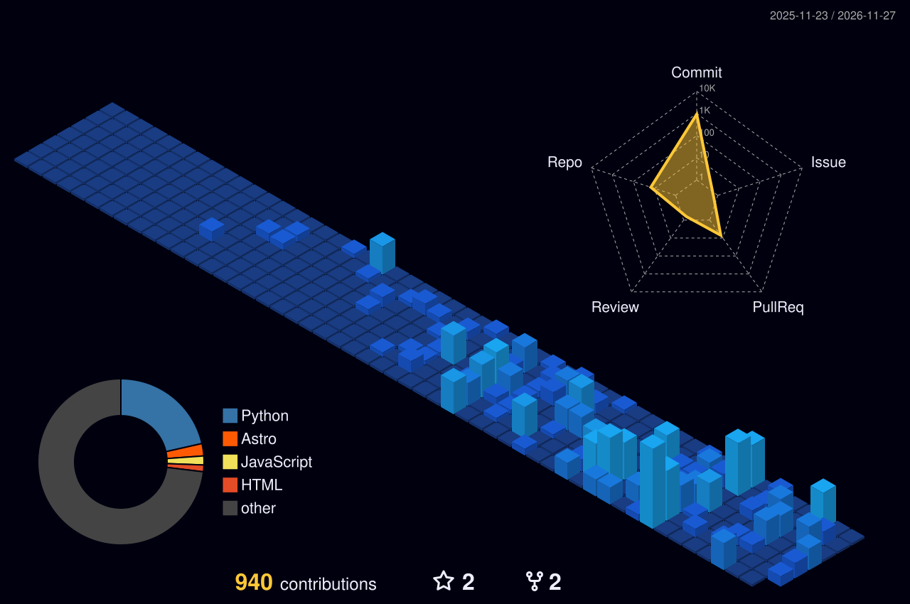

<h1 align="center">Winicius Passaia</h1>

Dev de sistemas • Automação e integrações

  

---

### Quem sou
Sou desenvolvedor de sistemas e websites, com o combo de automações e integrações: chatbots para WhatsApp, n8n e APIs. Também atuo como pesquisador, desenvolvendo um sistema web de gestão clínica. Vim do design e da computação gráfica, então também cuido de como as coisas ficam pra quem usa.

No momento estou me aprofundando em desenvolvimento agêntico: orquestrar agentes de IA, conectar ferramentas via MCP e cuidar do contexto e da memória entre sessões.

### Tecnologias

  

Também: n8n, APIs REST e webhooks

### Projetos em destaque
- **Sistema de gestão clínica**: sistema web modular para consultórios multiprofissionais, que desenvolvo como pesquisador *(repositório privado)*
- **[figsom](https://github.com/winipassaia/figsom)**: bot de WhatsApp que cria e envia figurinhas com som
- **[OBS_GestureNode](https://github.com/Espakki/OBS_GestureNode)**: controle do OBS Studio por gestos de mão, com visão computacional

### Fora do código
Toco baixo, gosto de me aventurar em problemas novos até achar a solução, mantenho um homelab, curto produzir vídeos e fazer stream e, no tempo livre, jogo bastante.

<picture>
  <source media="(prefers-color-scheme: dark)" srcset="profile-3d-contrib/profile-night-view.svg" />
  <source media="(prefers-color-scheme: light)" srcset="profile-3d-contrib/profile-green-animate.svg" />
  
</picture>
